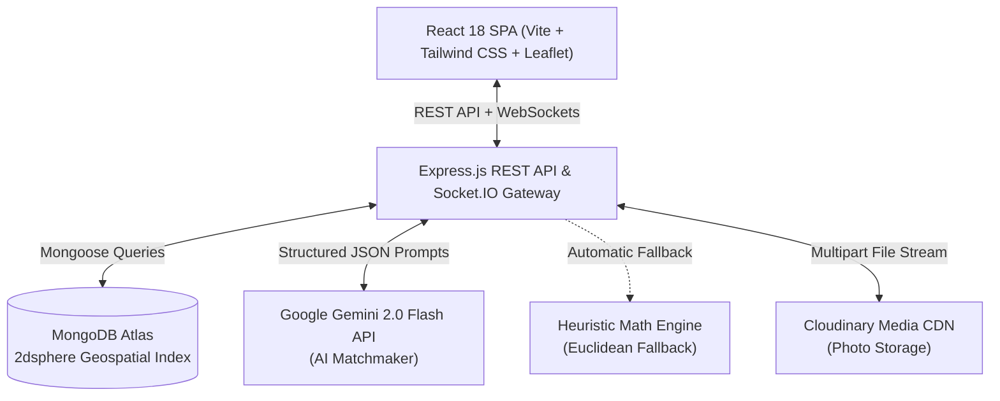

# FlatMate — Final Project Presentation Slide Deck

> **Project:** FlatMate — AI-Powered Flat & Roommate Matching Platform  
> **Target Audience:** Project Evaluators, Faculty Judges, Technical Review Committee  
> **Format:** Presentation Slides (compatible with Marp, slide previewers, or export to PPTX / PDF)  
> **Companion Document:** `docs/v3/DEMO_PRESENTATION_SCRIPT.md`

---

<!-- SLIDE 1 -->
# 🏠 FlatMate
### AI-Powered Flat & Roommate Matching Platform
**Solving Shared Housing Friction with Geospatial Discovery & Semantic AI**

* **Team:** Member 1 (Frontend), Member 2 (Backend), Member 3 (AI & DB), Member 4 (Lead Integrator)
* **Stack:** React 18 · Node.js · Express · MongoDB Atlas · Socket.IO · Google Gemini 2.0 Flash · Cloudinary
* **Target Focus:** Greater Noida Educational & Professional Hub

---

<!-- SLIDE 2 -->
# ❓ The Problem: Shared Living Friction
### Finding a flat is easy. Finding the *right roommate* is a gamble.

* **Lifestyle Clashes:** 73% of flatmate disputes stem from mismatched habits:
  * Nocturnal night owls roomed with 6 AM early birds.
  * Hygiene and chore sharing disagreements in shared washrooms/kitchens.
  * Noise tolerance, party frequency, and unannounced guest policies.
* **Geographical Blindspots:** Students and young professionals waste hours commuting due to inaccurate distance estimates.
* **Lack of Real-Time Trust:** Unresponsive listings, ghosting on messaging apps, and zero compatibility verification prior to lease signing.

---

<!-- SLIDE 3 -->
# 💡 The Solution: FlatMate
### An intelligent, two-sided ecosystem for hosts & seekers

1. **Geospatial Discovery:**
   * Interactive Leaflet maps + high-density grid browsing.
   * Real-time filtering by rent, room type, and Greater Noida sectors.
2. **AI Lifestyle Compatibility Engine:**
   * Multi-dimensional habit vectors captured at onboarding.
   * Qualitative semantic evaluation using **Google Gemini 2.0 Flash**.
3. **Event-Driven Real-Time Chat:**
   * Instant peer-to-peer messaging via **Socket.IO** with live typing indicators.
4. **Cloud-Native Media Storage:**
   * Streamed listing uploads via **Multer & Cloudinary CDN**.

---

<!-- SLIDE 4 -->
# 🏗️ High-Level System Architecture



* **Client-Side:** Fast, responsive single-page application built on Vite and Tailwind CSS.
* **Server-Side:** Event-driven Node/Express runtime handling both RESTful resources and stateful WebSocket connections.
* **Data Layer:** MongoDB Atlas with geospatial indexing and cached match collections.

---

<!-- SLIDE 5 -->
# 🧠 The AI Compatibility Engine: Two-Tier Architecture

### Tier 1: Geospatial & Role Filtering (MongoDB)
* Filters opposite roles: `HAS_ROOM` $\longleftrightarrow$ `SEARCHING_ROOM`.
* Proximity indexing via MongoDB `2dsphere` query:
  $$\$near: \{ \$geometry: \text{location}, \$maxDistance: 25000 \}$$

### Tier 2: Qualitative Semantic Matching (Gemini 2.0 Flash)
* Captures a 6-factor habit vector (scale 1–10):
  * **Sleep Schedule**, **Cleanliness**, **Smoking**, **Cooking**, **Guests**, **Noise**
* Gemini generates structured JSON:
  * **Compatibility Score** (0–100%)
  * **AI Vibe Summary** (2-sentence qualitative synergy)
  * **Pros & Alignments** (e.g. "Both quiet study after 10 PM")
  * **Considerations** (e.g. "Kitchen usage during morning rush")

---

<!-- SLIDE 6 -->
# 🛡️ Zero-Downtime Resilience: The Heuristic Fallback
### What happens if the AI API is rate-limited or offline?

* **The Problem:** Live demos and real production systems cannot crash if an external AI API times out.
* **The Solution:** A mathematical Euclidean difference fallback:
  $$\text{diffSum} = \sum_{k} |v_{A}[k] - v_{B}[k]|$$
  $$\text{Score} = \text{round}\left(100 - \frac{\text{diffSum}}{\text{maxDiff}} \times 100\right)$$
* **Automatic Failover:**
  * Gemini API call is wrapped in a strict **6-second `Promise.race()`** timeout.
  * If timeout or quota error triggers, the heuristic score is served instantly.
  * UI transparently displays the engine source: `Gemini 2.0 Flash` vs. `Heuristic Algorithm`.

---

<!-- SLIDE 7 -->
# 💬 Real-Time Messaging & Socket Architecture

### Low-latency communication without polling

* **Secure WebSocket Handshake:**
  * Client connects with JWT token in `auth.token`.
  * Server authenticates token in `io.use()` middleware before accepting connection.
* **Room-Isolated Chat:**
  * Users join dedicated rooms: `socket.join(chatId)`.
  * Messages broadcast only to room participants: `io.to(chatId).emit("receiveMessage", msg)`.
* **Instant Feedback & UX:**
  * Dynamic typing indicators: `user_typing` and `user_stop_typing`.
  * Message history populated with sender avatar, timestamp, and unread badges.

---

<!-- SLIDE 8 -->
# 📸 Media Management & Listing Pipeline

### Secure cloud uploads without server disk bloat

1. **Client Selection:** Host selects up to 5 room photos via `<input type="file" multiple />`.
2. **Streamed Upload:** Frontend transmits `multipart/form-data` payload.
3. **Multer & Cloudinary:**
   * Server streams incoming buffer directly to Cloudinary storage bucket.
   * Zero temporary files stored on local hosting dynos.
4. **Normalized Storage:**
   * Cloudinary returns secure HTTPS CDN URLs (`res.cloudinary.com/...`).
   * Stored directly in MongoDB `Listing.images` array.

---

<!-- SLIDE 9 -->
# 🗄️ Database Schema & Data Models

| Collection | Key Fields | Purpose |
|---|---|---|
| **Users** | `email`, `role`, `habitVector`, `location` (GeoJSON), `isVerified` | User identity, preferences, and coordinates for proximity queries |
| **Listings** | `title`, `rent`, `roomType`, `images`, `location`, `owner` (Ref) | Property data with `2dsphere` index for map markers |
| **Matches** | `userA`, `userB`, `compatibilityScore`, `pros`, `cons`, `vibeSummary` | Caches evaluated AI compatibility to eliminate redundant API calls |
| **Messages** | `chatId`, `senderId`, `participants`, `text`, `createdAt` | Persistent chat history for Socket.IO conversations |

---

<!-- SLIDE 10 -->
# 🔒 Security & Performance Highlights

* **Authentication & Authorization:**
  * Passwords hashed using industry-standard **bcrypt** (salt rounds: 10).
  * Stateless **JWT (JSON Web Tokens)** for protected REST routes and Socket.IO handshakes.
* **Server-Side Sender Verification:**
  * In `chatSocket.js`, incoming messages enforce: `senderId === socket.userId`.
  * Prevents user impersonation across active WebSocket rooms.
* **Performance Optimizations:**
  * Match caching: Evaluations cached permanently until habit vectors update.
  * Vite bundling with code-splitting for sub-second frontend loads.
  * Production SPA static rewrite handling on Render.

---

<!-- SLIDE 11 -->
# 🎬 Live Demonstration Journey

### Split-Screen Live Demo: Two Windows Side-by-Side

```
[ Left Window: Kartik Sharma (Host) ]     [ Right Window: Priya Mehra (Seeker) ]
--------------------------------------     --------------------------------------
1. Logged in as Host with open flat        1. Logged in as Seeker in Greater Noida
2. Receives incoming message notification  2. Browses Leaflet Map -> Clicks Kartik's Room
3. Replies in real-time                    3. Opens "AI Compatibility" -> 94% Match
4. Live typing indicator visible           4. Clicks "Message Host" -> Sends inquiry
```

* **Step 1:** Geospatial Map Search & Filter by Sector.
* **Step 2:** Deep-dive into Gemini's **AI Vibe Summary**, Pros, and Cons.
* **Step 3:** Bidirectional Socket.IO live chat & instant typing bubbles.
* **Step 4:** Live Room Creation with Cloudinary photo upload.

---

<!-- SLIDE 12 -->
# 🚀 Future Roadmap & Scaling Opportunities

* **AI Lease Agreement Summarizer:** Automatically flag restrictive landlord clauses or hidden maintenance charges using Gemini.
* **Automated Rent & Split-Bill Ledger:** Integrated expense splitting for groceries, Wi-Fi, and electricity bills inside active chats.
* **University Campus Verification:** Verified student badges via `.ac.in` / `.edu` institutional email verification.
* **Native Mobile Apps:** React Native migration reusing the existing REST + WebSocket backend.

---

<!-- SLIDE 13 -->
# 🎯 Summary & Key Takeaways

* **Addressed a Genuine Student Problem:** Transformed unpredictable roommate hunting into a data-driven, lifestyle-compatible process.
* **Full-Stack Technical Depth:**
  * Geospatial proximity search with MongoDB `2dsphere`.
  * Production AI integration with **Google Gemini 2.0 Flash**.
  * Fault-tolerant mathematical fallback.
  * High-concurrency bidirectional WebSocket chat.
* **Presentation-Ready & Deployed:** Full end-to-end functionality verified across all four member domains.

---

<!-- SLIDE 14 -->
# ❓ Questions & Discussion
### Thank You!

* **GitHub Repository:** FlatMate
* **Deployment Target:** Render (Web Service + Static Site)
* **Team:** Member 1 (Frontend) · Member 2 (Backend) · Member 3 (AI & DB) · Member 4 (Lead Integrator)
